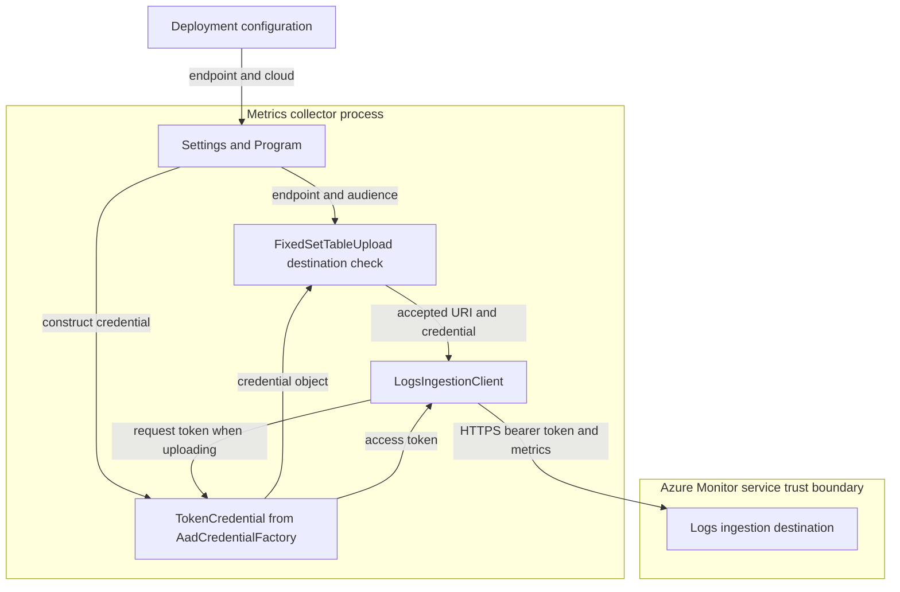

# ADR: Bind metrics uploads to Azure Monitor ingestion destinations

## Status

Proposed

- Owner and decider: @yophilav for the local change; record acceptance and repository-maintainer approval pending.
- Proposed: 2026-11-10.
- Review: local branch review; repository-maintainer review pending. No pull request or release approval.
- Implementation anchor: Azure/iotedge commit `498bc45aa85e3ddac2b744a4a44bdf2342c7cb52`.
- Language: STE-inspired; ASD-STE100 conformance not verified.

## Context

The metrics collector sends device metrics to Azure Monitor with an identity credential.
Deployment configuration selects the recipient and cloud. That configuration must not
be sufficient authority to send an Azure Monitor token to an unrelated service.

## Background and Motivation

Customers configure the collector's destination in their module deployment. They need:

- Metrics uploads to use official Azure Monitor ingestion destinations in the selected cloud.
- Supported cloud and Private Link deployments to keep their service-provided endpoint names.
- An unsupported destination to stop Azure Monitor uploads, with a clear configuration recovery.

## Goals & Non-Goals

### Goals

- DO: Bind this collector's authenticated Azure Monitor uploads to the official ingestion host policy.
- DONE WHEN: The publisher rejects destinations outside that policy before token acquisition, and the decision and recovery are reviewable.

### Non-Goals

- DON'T: Change identity selection, host permissions, IoT-message uploads, or add custom-gateway support.

Host identity isolation remains a host and identity-service responsibility. This collector
change does not restrict every action available to a deployment writer or an identity.

## Terminology

| Term | Definition |
| ---- | ---------- |
| Metrics collector | The `metrics-collector` module that gathers metrics and publishes them to the configured upload target. |
| Publisher | `FixedSetTableUpload`, the component that sends metrics through Azure Monitor's Logs Ingestion API. |
| Logs Ingestion API | Azure Monitor's application programming interface for sending records to a Log Analytics table. |
| DCE | Data collection endpoint: an Azure resource that supplies service ingestion URLs. |
| DCR | Data collection rule: the Azure resource that defines incoming records and their destination table. |
| Audience | The service for which an identity token is requested; it does not identify the network recipient. |
| TokenCredential | The Azure software development kit's token-provider interface, supplied by the existing credential chain. |
| URL / URI | A URL is a resource's network address; the publisher parses it as a .NET `Uri` value. |
| DNS | Domain Name System: the service that resolves an endpoint name to an address. |
| Private Link | Azure connectivity through a private endpoint; private DNS routes the service name to a private address. |
| HTTPS | HTTP protected by Transport Layer Security, including the server-certificate check. |

## High-Level Architecture

`Program` consumes deployment values through `Settings`. The publisher checks the
destination before creating `LogsIngestionClient`. Deployment values select a destination;
they do not extend the trusted service-host policy. The client receives the same checked
URI and the existing credential object.



The credential arrows show object transfer and token use, not the identity provider's
network topology. Identity sources remain unchanged. A rejected destination never creates
the ingestion client; credential allocation occurs earlier.

## Detailed design

### The collector uses the service-provided ingestion URL

The collector accepts a DCE ingestion URL or a direct DCR ingestion URL. Private Link
deployments use a DCE service URL and private DNS, not a literal private address or a
manually substituted private-link alias. The publisher does not require public DNS answers.

Deployment environment excerpt; `DataCollectionRuleId`, `DataCollectionStreamName`,
and `ResourceId` remain required. Identity configuration remains unchanged:

```json
{
  "UploadTarget": { "value": "AzureMonitor" },
  "AzureDomain": { "value": "azure.com" },
  "DataCollectionEndpoint": { "value": "https://my-dce.eastus-1.ingest.monitor.azure.com" }
}
```

Custom gateway hosts and address-literal URLs are intentionally unsupported. An operator must
replace those destinations with a service-provided URL, or choose another upload path.

### The publisher binds the recipient to the selected cloud

`AadCredentialFactory` already selects the cloud audience. The publisher reuses that
audience instead of adding another cloud selector, configurable allowlist, or bypass.
The host policy is fixed in the existing publisher boundary:

| `AzureDomain` | Audience | Accepted HTTPS hosts |
| ---- | ---- | ---- |
| `azure.com` | `AzurePublicCloud` | Subdomains of `ingest.monitor.azure.com`; `prod.la.ingest.monitor.core.windows.net` and its subdomains; `prod.la.ingestion.msftcloudes.com` and its subdomains. |
| `azure.us` | `AzureGovernment` | Subdomains of `ingest.monitor.azure.us`. |
| `azure.cn`, `azure.com.cn` | `AzureChina` | Subdomains of `ingest.monitor.azure.cn`. |

Subdomain matching requires a DNS label boundary. Host matching ignores case and terminal
DNS root dots. Unsupported cloud selectors or audiences are rejected. The public-cloud
families come from the published Logs Ingestion API endpoint table; the China DCE example
uses the China suffix. Those sources do not prove that every constructed hostname is an
operational customer endpoint.

The decision adds no separate port, path, or query restriction. It does not promise service
availability for arbitrary URL variants. Ingestion routing, metric serialization, upload
retries, and cancellation retain their existing behavior.

## Security & authentication

`Settings` checks absolute HTTPS configuration. The pinned ingestion client and bearer
policy do not supply this application's cloud-specific recipient restriction: the client
retains its supplied endpoint, and the audience selects the token scope.

The publisher therefore checks the parsed URI before ingestion-client construction and
passes that same URI to the client. The existing Identity credential constructors do not
acquire a token. The guarantee is rejection before token acquisition for this upload path,
not before credential allocation or all collector network activity.

| Input or outcome | Observable behavior |
| ---- | ---- |
| Parsed absolute URL outside the host, scheme, or audience policy | Publisher construction throws `ArgumentException`; no ingestion client or authenticated upload starts. |
| URL accepted by the policy | Publisher construction can proceed; service authorization and reachability are not established by that acceptance. |
| Missing fields or invalid URI syntax | Existing configuration and URI validation still apply; no new error taxonomy is introduced. |
| Publisher setup failure in `Program` | Setup logs an error, skips the scrape/upload loop, and retains the existing zero process exit code. |

The operator corrects `DataCollectionEndpoint` and `AzureDomain` in the deployment and
redeploys. The decision does not change process-exit or runtime-health reporting.

## Open questions

- Does the fix behave as required in a deployed collector image? Close with an authorized
  prior-image and corrected-image comparison in the target environment. Image-level
  verification has not been performed.
- Do the supported cloud and Private Link deployments work end to end? Close with authorized
  cloud-specific upload and private-DNS qualification. Local constructor tests and source
  review do not supply this evidence or release approval.

## Appendix A: Decision history

### Can HTTPS and token audience replace a recipient check?

- **Tried:** Source review of the pinned ingestion client and bearer policy established that they retain a supplied endpoint without the required service-host restriction. The constructor cases in `MigrationTests` check accepted and rejected destinations with a strict credential mock; the local component suite passed 53 tests. These checks do not prove a live token disclosure or affected-image remediation.
- **Options:**
  - Keep HTTPS and audience checks alone: the dependency contract leaves the configured recipient unrestricted.
  - Add the publisher host policy: the constructor tests exercise rejection before credential calls without a new dependency or public interface.
- **Decision:** The owner authorized collector-only, official-ingestion-only scope before implementation. Commit `498bc45` implements that scope on 2026-11-10. This record remains proposed pending acceptance.
- **Revisit if:** The ingestion dependency supplies an equivalent cloud-specific recipient check before token use, or a supported service endpoint no longer fits the published host families.

## Appendix B: Reference labels

No reference labels are used.

## Appendix C: Links

Local source paths below refer to the implementation anchor in Status.

- [Publisher constructor, host policy, and upload behavior](src/FixedSetTableUpload/FixedSetTableUpload.cs).
- [Program setup ordering and recovery](src/Program.cs).
- [Cloud mapping and credential chain](src/FixedSetTableUpload/AadCredentialFactory.cs).
- [Configuration validation](src/Settings.cs).
- [Operator configuration](src/README.md).
- [Deployment environment shape](src/ExampleDeployment.json).
- [Constructor cases in MigrationTests](tests/Microsoft.Azure.Devices.Edge.Azure.Monitor.Test/MigrationTests.cs).
- [LogsIngestionClient, Azure.Monitor.Ingestion 1.2.0](https://github.com/Azure/azure-sdk-for-net/blob/Azure.Monitor.Ingestion_1.2.0/sdk/monitor/Azure.Monitor.Ingestion/src/LogsIngestionClient.cs).
- [BearerTokenAuthenticationPolicy, Azure.Core 1.50.0](https://github.com/Azure/azure-sdk-for-net/blob/Azure.Core_1.50.0/sdk/core/Azure.Core/src/Pipeline/BearerTokenAuthenticationPolicy.cs).
- [EnvironmentCredential, Azure.Identity 1.17.1](https://github.com/Azure/azure-sdk-for-net/blob/Azure.Identity_1.17.1/sdk/identity/Azure.Identity/src/Credentials/EnvironmentCredential.cs).
- [WorkloadIdentityCredential, Azure.Identity 1.17.1](https://github.com/Azure/azure-sdk-for-net/blob/Azure.Identity_1.17.1/sdk/identity/Azure.Identity/src/Credentials/WorkloadIdentityCredential.cs).
- [ManagedIdentityCredential, Azure.Identity 1.17.1](https://github.com/Azure/azure-sdk-for-net/blob/Azure.Identity_1.17.1/sdk/identity/Azure.Identity/src/Credentials/ManagedIdentityCredential.cs).
- [Logs Ingestion API endpoint contract](https://learn.microsoft.com/en-us/azure/azure-monitor/logs/logs-ingestion-api-overview#endpoint), retrieved 2026-11-10; Learn source revision `253305bd46b99b381d3fca925ba04ab2d6bbe3e6`.
- [Logs Ingestion API host families and Government endpoints](https://learn.microsoft.com/en-us/azure/azure-monitor/fundamentals/azure-monitor-network-access#logs-ingestion-api-endpoints), retrieved 2026-11-10; Learn source revision `54083572c1c53fc1e381892d53ce2f382d498478`.
- [Private Link DNS configuration](https://learn.microsoft.com/en-us/azure/azure-monitor/fundamentals/private-link-configure#review-endpoints-dns-settings), retrieved 2026-11-10; Learn source revision `912765c6d88138ffc2535b2104d466b16d38d252`.
- [Azure China DCE sample](https://docs.azure.cn/en-us/azure-monitor/data-collection/data-collection-endpoint-overview#sample-data-collection-endpoint), retrieved 2026-11-10; this is a dated live-page reference, not an immutable source revision.
